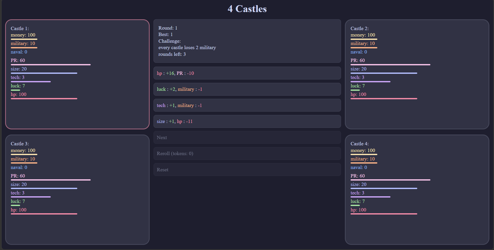

# 4 castles
a game of 4 split castles in the kingdom of Prism, where you are the heir to all 4 kingdoms, however if you fail any 1 castle they will revolt and you loose.

## gameplay / how to play
you get 4 options each turn the first option you select will aplly to the first castle, seccond option you pick will apply to seccond castle and so on.

Each option will add one stat and takeaway a diffrent stat.

After you have used all 4 cards you can click next to move on to the next round and the options will refresh.

Evry couple of rounds you will have a tax or challenge to beat or suffer from.

some options will give a bonus reroll token.

reroll tokens can be used to reroll any avalible options (the already used ones won't be rolled)

## idea behind the game
I personally like ressource manegement games, I think they are pretty fun, and I wanted to try my hand at one. The main theme for the game was split, so I went with split kingdoms and you have to manage them all. 

## credits
me - robopugo - no10123

Built for tera